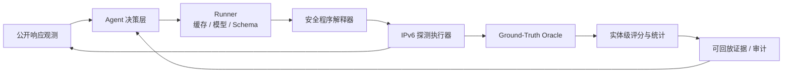

# mentors-task

**把 IPv6 主动探测中的“下一步探哪里、探多少、用什么方法”交给一个可评测、可回放、可审计的 Agent。**

[](https://github.com/David-coder-hnu/mentors-task/actions/workflows/test.yml)


这是一个研究型开源仓库，包含完整的 IPv6 探测评测台、Agent 决策层、基线与实验分析。
项目关心的不是“再多发几个探测包”，而是：

> 当回包数量可能欺骗测量者时，怎样判断一个 Agent 是否真的发现了更多网络实体？

---

## 为什么这个项目值得看

### 1. 回声会“撒谎”

在 IPv6 外围探测中，某些前缀会显得异常热闹：几乎每个地址都有响应。但这些响应可
能源自同一个路由器，真正的新信息很少。这种现象称为 **aliasing / FRP（全响应前缀）**。

如果策略只追求响应率，它越努力，可能越容易把预算花在信息量最低的地方。

### 2. Agent 不只是“调参数”

传统算法的优势通常来自在一个固定动作空间里做精细分配。本项目研究的是更上一层：

> Agent 能否根据当前观测，临时选择、组合和切换探测程序？

项目把这个问题写成可证伪实验，而不是停留在“LLM 应该更聪明”的判断上。

### 3. 先建标准答案，再谈 Agent 是否更好

仓库同时维护策略面与真值面：

- 策略只能看到公开响应；
- 真值只交给 runner 和评分器；
- 所有决策、预算和报告均可缓存、回放和审计；
- 结果使用同一 seed 配对检验，而不是比较不可比的单次运行。

---

## 当前进展

| 模块 | 状态 |
|---|---|
| Punching Bag Stage 1 真靶场 | 已运行 30 seeds、45,000 次探测 |
| RouterShim Stage 2 测试床 | 已完成 6 条静态基线、180,000 次探测 |
| A1 / A2 / A3 Agent 决策层 | 已接通安全 DSL、预算账本、缓存与确定性报告 |
| P1 `broad` 真实模型场景 | 已完成 30 seeds、900 次决策、900/900 缓存重放 |
| T7 6Sense 去别名化兼容轨道 | 已通过 `aliasv6 + scanv6` 验收 |
| P1 其余三个预注册场景 | 待运行 |
| 真实 IPv6 互联网外部效度 | 尚未验证 |

最新公开状态以 [P1 broad 结果](docs/results/p1-real-broad-2026-11-23.md) 和
[文档索引](docs/README.md) 为准。

---

## 核心结果

### P1 `broad`：开放动作空间确实有效

在 32 个前缀、每趟 1,000 次探测的 RouterShim 场景中：

| 策略 | 平均发现路由器 | aliased waste |
|---|---:|---:|
| A1：固定工具池 | 11.30 | 80.00% |
| A2：运行期组合程序 | **28.67** | **24.80%** |
| A3：opaque 编码 | 25.83 | 24.67% |
| B5-open：人工冻结程序 | 55.77 | 20.48% |

A2 相对 A1：

- 平均多发现 **17.37 个路由器**；
- aliased waste 降低 **55.2 个百分点**；
- 同 seed 配对检验 Holm `p=5.26e-06`。

这说明“允许组合新方法”本身是一个有效方向。

### Agent 与人工程序仍然有明显距离

同场景的人工 B5-open 平均发现 55.77 个路由器，高于 A2 的 28.67 个。

这不是失败，而是一个很有价值的研究信号：

> 当前收益主要来自开放动作空间，而不是已经证明的 LLM 独特推理能力。

下一阶段最值得研究的问题是：Agent 能否在这个开放空间中构造出人工没有预见、
但在真值上更优的程序？

### 只数回包会掉进陷阱

Stage 1 的真靶场结果表明，追高响应率会显著增加 aliased waste。
当前跨 run UCB1 记忆设计没有改善识别，反而放大了浪费：

| 策略 | aliased waste | caught |
|---|---:|---:|
| B4：响应率 bandit | 48.1% | 7.9 |
| M1：记忆冷启动 | 48.1% | 8.0 |
| M2：跨 run 记忆 | 70.7% | 8.0 |

这为下一轮记忆设计提供了清晰方向：记忆应该围绕“不同来源、实体去重和陷阱识别”，
而不是简单记住“哪个区域回包多”。

---

## 项目架构



关键边界：

1. **策略侧**只能看到 `ProbeSurface` 提供的公开响应。
2. **runner 侧**持有真值、预算账本、模型调用和决策缓存。
3. **生成式动作**只能通过受限 DSL 表达，不能直接执行任意代码。
4. 最终 aliased 判定由三组 Agent 共用的确定性规则产生。

---

## Agent 是怎样工作的

Agent 按回合决策。在 P1 `broad` 中：

- 每 100 次探测构成一个 epoch；
- 每个 epoch 结束后读取一次状态；
- 下一次动作必须恰好花完当前预算；
- 每趟 1,000 次探测共有 10 次决策。

Agent 可以组合的安全 DSL 例如：

```json
{
  "action": "compose",
  "name": "mixed_program",
  "steps": [
    {"target": "unprobed", "fraction": 0.5},
    {"target": "responsive", "fraction": 0.5}
  ],
  "count": 100,
  "reason": "一半预算探索新区域，一半预算追踪有响应的区域"
}
```

这段程序的含义很直接：50% 预算去没探过的地方，50% 追踪有响应的区域。

### 实验行

| 行 | 含义 |
|---|---|
| A1 | 固定菜单：每回合只能选一个前缀 |
| A2 | 开放组合：运行期拼出新的多步程序 |
| A3 | 遮住地名：把地址换成 opaque token |
| B5-closed | 人写的固定去别名化与发现策略 |
| B5-open | 人提前写好并冻结的开放 DSL 程序 |

---

## 当前能证明什么

可以支持的结论：

- 评测台能区分“回包多”与“真实实体多”；
- aliasing 陷阱可复现；
- 开放动作空间在 `broad` RouterShim 场景中显著优于固定工具池；
- Agent 的决策、预算、缓存、回放和审计链路已经完整可运行；
- 当前 UCB1 跨 run 记忆设计需要重新考虑。

不能支持的结论：

- 不能说 Agent 已经优于同能力人工方案；
- 不能把单个 `broad` 场景外推为四场景总体结论；
- 不能把 RouterShim 结果外推为真实互联网性能；
- 不能声称已经复现完整 6Sense LSTM 生成器。

---

## 快速开始

运行期零第三方依赖，仅使用 Python 标准库；测试依赖 `pytest`。

```bash
python3 -m venv .venv
.venv/bin/python -m pip install pytest

make test
```

Windows：

```powershell
.venv\Scripts\python.exe -m pip install pytest
.venv\Scripts\python.exe -m pytest
```

当前基线：

- 本机：**721 passed, 7 skipped**
- Linux 容器：**728 passed**

---

## 复现关键实验

### Stage 1：Punching Bag 真靶场

需要 Linux、Docker 与 `CAP_NET_RAW`。

```bash
make smoke-table SEEDS=0-29
make analyze-stage1
```

### Stage 2：RouterShim 静态基线

```bash
make stage2-baselines SEEDS=0-29
make analyze-stage2
```

### P1：开放动作空间

```bash
make p1-power
make tune-b5-open
make p1-fixture
make analyze-p1
make p1-audit
```

### P1 broad：真实模型证据

已有真实决策缓存时，可以无模型调用地重放：

```bash
make p1-live-replay
make p1-live-b5
make p1-evidence
```

`p1-evidence` 会生成：

- 配对统计与置信区间；
- B5-open / B5-closed 对照；
- 构造与组合尝试审计；
- API / completion 调用账本；
- 900 条 epoch 决策记录。

### T7：6Sense 去别名化兼容验收

```bash
make 6sense-compat
```

---

## 仓库结构

```text
.
├── IPv6_Agent_探测_设计方案.md   # 权威设计文档
├── README.md
├── TODOS.md
├── Makefile
├── config/
│   ├── stage1_config.json
│   ├── stage2_config.json
│   ├── p1/                      # 预注册场景、功效与 B5-open 冻结记录
│   ├── protocols/               # DSL 与原语 schema
│   └── heldout/                 # 独立留出集
├── src/
│   ├── adapter/                 # ProbeSurface、Oracle、沙箱、RouterShim
│   ├── agent/                   # A1/A2/A3、缓存、状态与安全 DSL
│   ├── baselines/               # B0-B5、M1/M2、B5-open
│   ├── scoring/                 # 实体级评分、统计与报告
│   └── experiment/              # 矩阵、会话、决策代理与 CLI
├── docker/                      # Punching Bag 与 harness
├── scripts/                     # 实验、分析与审计入口
├── tests/                       # 单测与 Linux 集成测试
└── docs/                        # 结果、协议、计划与公开边界
```

重点文档：

- [文档索引](docs/README.md)
- [Stage 1 结果](docs/results/stage1-2026-11-10.md)
- [Stage 2 结果](docs/results/stage2-2026-11-10.md)
- [P1 broad 真实模型结果](docs/results/p1-real-broad-2026-11-23.md)
- [P1 工程闭环](docs/results/p1-engineering-2026-11-23.md)
- [T7 6Sense 兼容轨道](docs/results/t7-6sense-compat-2026-11-10.md)
- [P1 预注册协议](docs/protocols/p1_preregistration.md)
- [对等投入协议](docs/protocols/equal_effort.md)

---

## 两条不可破坏的实验约束

1. **真值隔离**

   策略进程只能经 `ProbeSurface` 看到公开响应，不能读取 `config/`、真值文件或其他
   策略缓存。进程边界和沙箱负责强制执行。

2. **状态规范化**

   并发响应会改变到达顺序。进入缓存键的状态必须规范化，否则同一实验无法重现，
   缓存也会静默失效。

---

## 公开发布边界

公开仓库及其 Git 历史不包含第三方论文原文、全文翻译或导师调研报告原件。
受限材料只保留在项目所有者管理的私有离线备份中。

- 发布规则：[docs/PUBLIC_RELEASE.md](docs/PUBLIC_RELEASE.md)
- 后续贡献不得提交论文全文或私人研究材料；
- 引用第三方工作时使用标题、DOI、官方链接和必要短引用。

---

## 第三方组件与许可证

| 组件 | 许可证 | 使用方式 |
|---|---|---|
| [Punching Bag](https://github.com/tumi8/punching-bag) | AGPL-3.0 | Docker 构建期拉取并锁定 commit，不 vendor 源码 |
| 6Sense | 上游公开代码 | T7 使用 `aliasv6 + scanv6` 做兼容验收 |

本仓库自有代码目前尚未附加 `LICENSE`。**公开可见不等于自动授予再使用许可**；
正式复用或分发前应先确定许可证。

---

## 引用

如果本项目的方法或评测台设计对你有帮助，请优先引用其基础靶场工作：

- Steger, Junginger, Carle, Zirngibl.
  **Punching Bag: A Ground-Truth Testbed for IPv6 Address Discovery.**
  ACM IMC 2026.
  [DOI: 10.1145/3777912.3839826](https://doi.org/10.1145/3777912.3839826)

---

## 项目状态

这是一个**持续演进的研究原型**，不是生产扫描器。目标是让 IPv6 Agent 的优势能够被
公平地测量、复现和证伪。

当前最重要的一步，是把已经打通的方法从 `broad` 场景扩展到完整预注册矩阵，并继续
探索 Agent 在开放动作空间中的独特增益。
